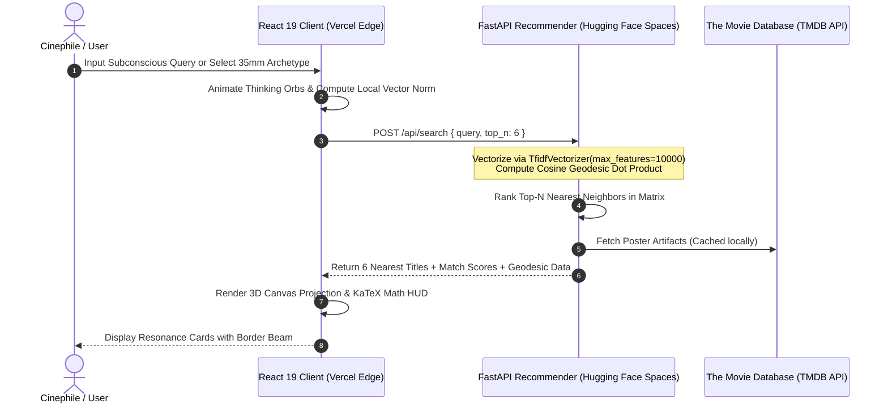

# <p align="center">ROOM 7.5 — High-Dimensional Latent Vector Cinema Engine</p>

<p align="center">
  
  
  
  
  
  
  
  
</p>

<p align="center">
  <b>Find films by the feeling they leave behind. Search 4,800+ cinema titles across a 10,000-dimensional Hilbert space $\mathcal{H} = \ell^2(\mathbb{R}^{10,000})$ using TF-IDF projection and cosine geodesics.</b>
</p>

<p align="center">
  <a href="https://huggingface.co/spaces/sovon19/room75-api"><b>🤗 Hugging Face Space</b></a> •
  <a href="https://sovon19-room75-api.hf.space/docs"><b>⚡ Interactive Swagger API Docs</b></a> •
  <a href="https://sovon19-room75-api.hf.space"><b>🌌 Live Vector Engine</b></a>
</p>

---

## 🏛 System Architecture

The system utilizes an asynchronous decoupled architecture:
1. **Frontend Edge:** React 19 + TypeScript + Vite deployed on **Vercel Global Edge CDN** (0ms cold start, sub-millisecond static asset delivery).
2. **Vector Backend:** High-throughput Python FastAPI machine learning engine deployed on **Hugging Face Spaces** (2 vCPU, 16 GB RAM, 24/7 always-on container).
3. **Poster Ingestion:** Intelligent asynchronous TMDB poster caching with local JSON store.



---

## 📐 Mathematical Formulation

### 1. Document-Term Weighting & Soup Construction
For each film $d \in \mathcal{D}$ (where $|\mathcal{D}| = 4,803$), a comprehensive semantic representation is constructed from the overview tokens, genres, and contextual keywords:

$$\text{Soup}(d) = \text{Overview}(d) \cup \text{Genres}(d) \cup \text{Keywords}(d)$$

Term Frequency-Inverse Document Frequency (TF-IDF) projects every document into a sparse vector $\mathbf{v}_d \in \mathbb{R}^{10,000}$:

$$\text{TF-IDF}(t, d, \mathcal{D}) = \text{TF}(t, d) \times \left( \ln\left(\frac{1 + |\mathcal{D}|}{1 + |\{d' \in \mathcal{D} : t \in d'\}|}\right) + 1 \right)$$

### 2. Hypersphere Geodesic Distance
All vectors are normalized onto the unit hypersphere $\mathbb{S}^{9999}$:

$$\hat{\mathbf{v}} = \frac{\mathbf{v}}{\|\mathbf{v}\|_2} = \frac{\mathbf{v}}{\sqrt{\sum_{i=1}^{10000} v_i^2}}$$

Given a normalized user prompt vector $\hat{\mathbf{q}}$, the resonance similarity with document vector $\hat{\mathbf{v}}_d$ corresponds to their inner product:

$$\text{Resonance}(\hat{\mathbf{q}}, \hat{\mathbf{v}}_d) = \langle \hat{\mathbf{q}}, \hat{\mathbf{v}}_d \rangle = \cos(\theta)$$

The geodesic angular separation on the manifold is computed in real time by the KaTeX mathematical telemetry HUD:

$$\theta = \arccos\left(\text{clamp}(\cos(\theta), 0, 1)\right) \times \frac{180}{\pi} \quad [\text{degrees}]$$

---

## ✨ Features

- **Dual Projection Search Modes:**
  - `Exact Title Resonator`: Locates exact matches or partial string anchors, computing vector neighborhood distance relative to the seed film.
  - `Subconscious Vibe / Fever Dream`: Performs high-dimensional projection of arbitrary descriptive prompts (e.g. *"lonely replicant searching for human soul in neon dystopian rain"*).
- **35mm Celluloid Ribbon:** Real-time archetype filmstrip with sprocket holes featuring iconic cinema archetypes (Ryan Gosling Blade Runner 2049, Sukuna, La La Land, Meet Joe Black).
- **Bioluminescent Thinking Orbs:** Dynamic fluid multi-orb loading animation with high-speed vortex rotation and shockwave pulse upon vector ignition.
- **CSS `@property` Border Beam:** Synchronized conic-gradient border illumination engine wrapping cards and input consoles.
- **Interactive 3D Vector Space Canvas:** Real-time particle system rendering the 10,000-D manifold projected down to 3D with interactive mouse parallax.
- **Synchronous KaTeX Telemetry:** Live mathematical readout displaying active query tokens, Euclidean $L^2$ vector norms, and geodesic angles.

---

## 📁 Repository Structure

```text
room-7.5/
├── backend/
│   ├── app.py                   # Production FastAPI service with CORS & TMDB layer
│   ├── requirements.txt         # Core dependencies (FastAPI, scikit-learn, pandas)
│   ├── Dockerfile               # Production Docker container definition
│   └── data/
│       ├── tmdb_5000_movies.csv # TMDB dataset (4,803 films)
│       └── poster_cache.json    # Cached poster assets
├── frontend/
│   ├── src/
│   │   ├── MovieRecommender.tsx # Main cinema engine UI component
│   │   ├── MovieRecommender.css # Custom design system & animations
│   │   ├── App.jsx              # React root wrapper
│   │   └── main.jsx             # Entrypoint
│   ├── vercel.json              # Vercel Edge SPA routing configuration
│   ├── package.json             # React 19, KaTeX, Vite
│   ├── .env.example             # Example environment variables
│   └── vite.config.js           # Vite build pipeline
├── docker-compose.yml           # 1-command fullstack local environment
└── README.md                    # Project documentation & architecture
```

---

## 🚀 Quickstart

### Option A: 1-Command Boot with Docker Compose
If you have Docker installed, simply run:

```bash
docker compose up --build
```
- Frontend: `http://localhost:5173`
- Backend API & Interactive Swagger Docs: `http://localhost:7860/docs`

---

### Option B: Manual Local Setup

#### 1. Backend (FastAPI + Python 3.10+)
```bash
cd backend
python -m venv venv
# On Windows:
.\venv\Scripts\activate
# On Linux/macOS:
source venv/bin/activate

pip install -r requirements.txt
python app.py
```
*Backend runs on `http://localhost:7860` with interactive docs at `/docs`.*

#### 2. Frontend (React 19 + Vite)
```bash
cd frontend
npm install
npm run dev
```
*Frontend runs on `http://localhost:5173`.*

---

## 🌐 Production Deployment

### 1. Backend on Hugging Face Spaces (Free Forever, 16GB RAM)
1. Create a new Space at [huggingface.co/new-space](https://huggingface.co/new-space).
2. Choose **Docker** as SDK and **Public** visibility.
3. Upload all contents of the `backend/` folder.
4. Your API will be live at `https://<username>-<space-name>.hf.space`.

### 2. Frontend on Vercel Edge CDN
1. Import this repository into [vercel.com/new](https://vercel.com/new).
2. Set Root Directory to `frontend`.
3. Add Environment Variable:
   - `VITE_API_URL` = `https://<username>-<space-name>.hf.space`
4. Click **Deploy**.

---

## 📄 License
This project is licensed under the MIT License.

## 👤 Author
**Md. Shahidul Islam Shovan** ([@sovon1](https://github.com/sovon1))  
*Department of Computer Science & Telecommunication Engineering (CSTE), NSTU*
